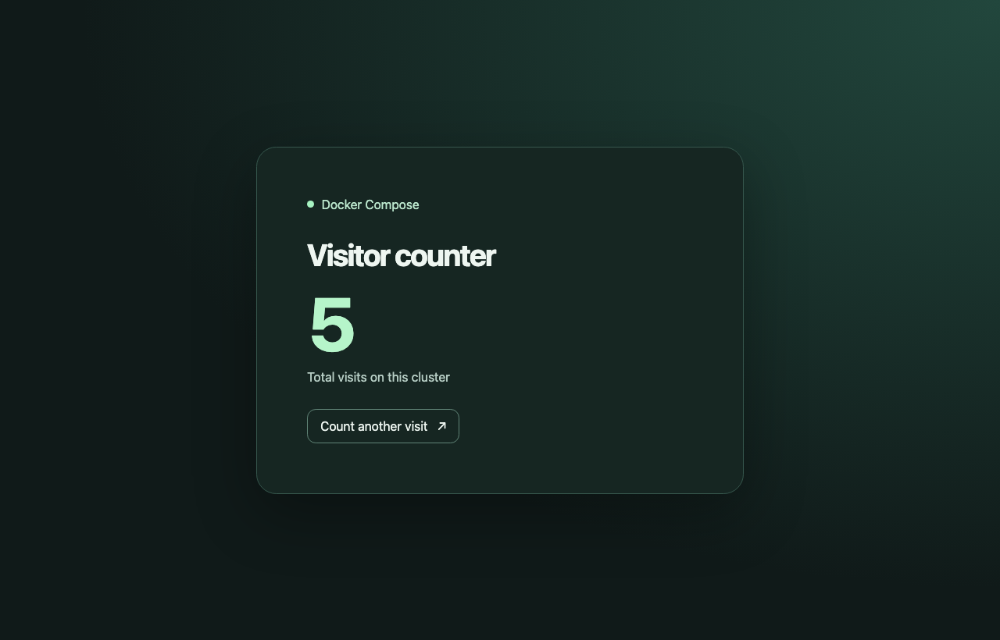
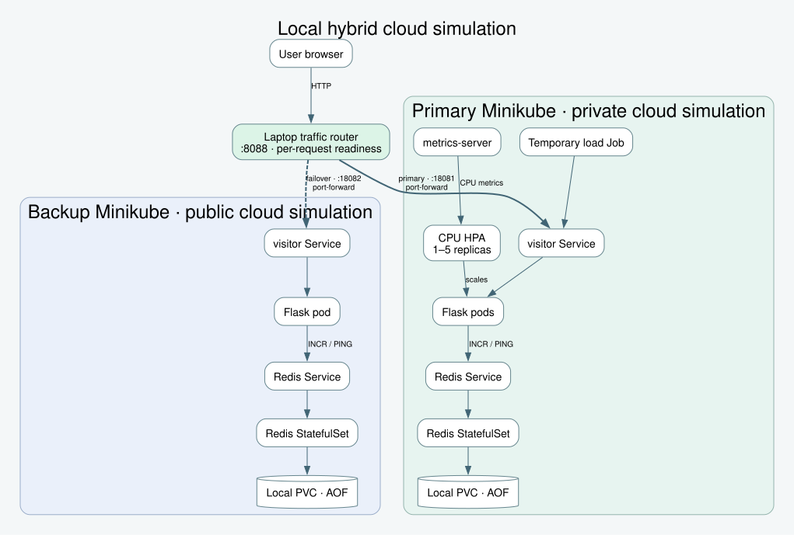
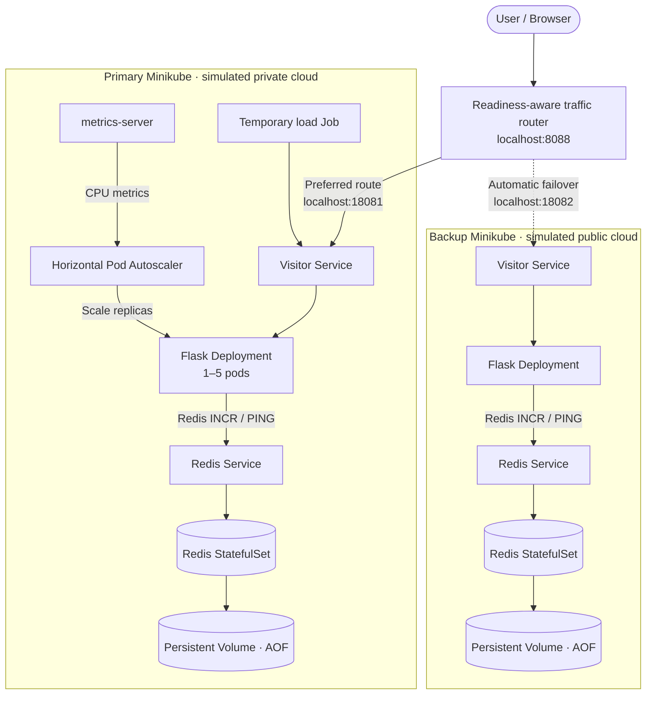
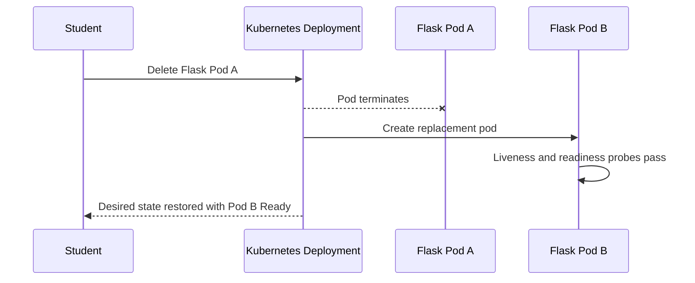
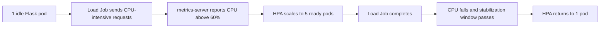
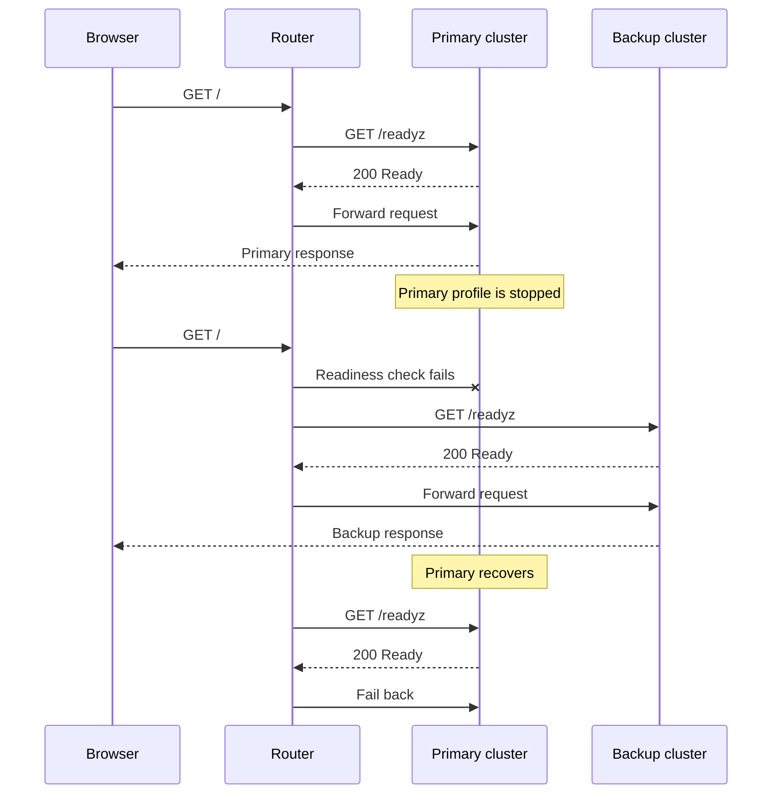

<div align="center">

# ☁️ Visitor Counter Cloud Platform

### Flask · Redis · Docker · Kubernetes · HPA · Local Hybrid-Cloud Failover

**Created by Divye Bhatnagar**

[](https://www.python.org/)
[](https://flask.palletsprojects.com/)
[](https://redis.io/)
[](https://www.docker.com/)
[](https://kubernetes.io/)
[](docs/testing.md)
[](LICENSE)

**A complete Cloud Computing university project that takes one small web application through containerization, orchestration, self-healing, autoscaling, local hybrid-cloud failover, and measured resource optimization.**

[Explore the architecture](#-system-architecture) · [Run the project](#-quick-start) · [View verified results](#-verified-results) · [Read the report](report/public-report.md)

</div>

---

## ✨ What makes this project special

This is a working, evidence-backed cloud deployment built and tested on a real laptop. Every browser visit is counted atomically through Redis `INCR`. Kubernetes keeps the web tier healthy, scales it under CPU pressure, and replaces failed pods. A readiness-aware router demonstrates failover between two independent Minikube clusters.

> [!IMPORTANT]
> The hybrid-cloud environment is a **LOCAL HYBRID CLOUD SIMULATION**. `vc-primary` represents a private cloud and `vc-backup` represents a public cloud. Both clusters run locally in Minikube, so no paid cloud account is required.

<div align="center">
  
  <br>
  <sub>The responsive visitor-counter interface running on the project laptop</sub>
</div>

## 🎯 Five compulsory cloud tasks

| Task | Implementation | Verified outcome |
| --- | --- | --- |
| **A · Containerization** | Flask and Redis in separate containers with Docker Compose networking, health checks, and a named Redis volume | Both containers healthy and consecutive requests incremented the counter |
| **B · Kubernetes** | Flask Deployment and Service, Redis StatefulSet and headless Service, PVC, probes, requests, and limits | Both clusters reached Ready and a deleted Flask pod was replaced |
| **C · HPA autoscaling** | `autoscaling/v2`, metrics-server, 60% CPU target, 1–5 replicas, reproducible Kubernetes load Job | Flask scaled **1 → 5 → 1** replicas |
| **D · Hybrid failover** | Two Minikube profiles, two contexts, retrying port-forwards, and a readiness-aware Python router | Traffic changed **primary → backup → primary** with HTTP 200 responses |
| **E · Cost optimization** | Resource right-sizing, idle-replica reduction, and full-versus-slim image comparison | Three measured before/after comparisons recorded in CSV |

## 🏗️ System architecture



<details>
<summary><strong>Open the Mermaid architecture source</strong></summary>



</details>

The two Redis databases are deliberately independent. Backup traffic increments the backup counter, and those values do not synchronize back to the primary. This makes the data-consistency limitation visible instead of hiding it.

## 🔁 Cloud behavior at a glance

### Kubernetes self-healing



### HPA scale-up and scale-down



### Local hybrid-cloud failover



## 📊 Verified results

All values below came from the project laptop. No cloud bill or monetary saving is claimed.

| Measurement | Before | After | Improvement |
| --- | ---: | ---: | ---: |
| Idle Flask replicas | 3 | 1 | **66.67% fewer** |
| CPU request per pod | 250m | 100m | **60.00% lower** |
| Memory request per pod | 128 MiB | 64 MiB | **50.00% lower** |
| Total requested CPU | 750m | 100m | **86.67% lower** |
| Total requested memory | 384 MiB | 64 MiB | **83.33% lower** |
| ARM64 Docker image size | 404,473,719 B | 47,152,940 B | **88.34% smaller** |

Additional observations from the verified run:

- **6/6 Python tests passed**, including a live Redis integration test and router failover tests.
- The HPA load Job completed with **4,864 successful requests** and seven failed requests during scaling.
- Kubernetes replaced pod `visitor-857f7d9864-xjts8` with `visitor-857f7d9864-v5bnq`.
- Failover returned HTTP 200 from the backup while the primary profile was stopped, followed by successful failback.

See the [comparison CSV](cost-analysis/comparison.csv), [raw laptop evidence](evidence/README.md), and [test outcomes](docs/testing.md).

## 🚀 Quick start

### Prerequisites

- Docker Desktop with Docker Compose
- Python 3 and Git
- Minikube and kubectl for Kubernetes demonstrations
- At least 8 GB assigned to Docker Desktop for the two-cluster exercise

The [environment setup guide](docs/setup.md) contains verified macOS instructions and Windows/WSL alternatives.

### Run with Docker Compose

```bash
git clone https://github.com/DivyeBhatnagar/Cloud-Computing-Project-Visitor-Count-.git
cd Cloud-Computing-Project-Visitor-Count-
docker compose up -d --build --wait
python3 scripts/smoke.py http://127.0.0.1:8080
```

Open <http://127.0.0.1:8080> and refresh to increment the counter.

```bash
docker compose ps
docker compose logs --tail 20 web redis
docker compose down
```

### Run on the primary Kubernetes cluster

```bash
minikube start -p vc-primary --driver=docker --cpus=2 --memory=2560
minikube addons enable metrics-server -p vc-primary
docker build -t visitor-counter:local .
bash scripts/deploy.sh vc-primary
bash scripts/forward.sh vc-primary
```

Open <http://127.0.0.1:18081>. The complete walkthrough for self-healing, HPA, both clusters, failover, measurements, and cleanup is in the [demonstration runbook](docs/demo.md).

## 🧪 Tests and validation

```bash
python3 -m venv .venv
.venv/bin/python -m pip install -r requirements.txt
bash scripts/test-local.sh
```

The full laptop demonstration can be repeated with:

```bash
bash scripts/record-compose.sh
bash scripts/validate-clusters.sh
```

> [!CAUTION]
> `validate-clusters.sh` performs the complete demonstration. It generates load and temporarily stops the primary Minikube profile to prove failover.

## 🩺 Application endpoints

| Endpoint | Purpose | Redis required |
| --- | --- | --- |
| `/` | Atomically increments and displays the visitor count | Yes |
| `/healthz` | Confirms that the Flask process is alive | No |
| `/readyz` | Confirms that Flask can reach Redis | Yes |
| `/demo-load` | Opt-in CPU workload used only for the HPA demonstration | No |

| Environment variable | Default | Purpose |
| --- | --- | --- |
| `REDIS_URL` | `redis://127.0.0.1:6379/0` | Redis connection URL |
| `COUNTER_KEY` | `visitor-count` | Shared Redis counter key |
| `CLUSTER_ID` | `Local` | Visible cluster label and response header |
| `ENABLE_LOAD_TEST` | Disabled | Enables the HPA demonstration endpoint when set to `1` |

## 🗂️ Repository map

```text
.
├── app.py                     # Flask application and health endpoints
├── Dockerfile                 # Non-root, health-checked web image
├── docker-compose.yml         # Flask + persistent Redis locally
├── k8s.yaml                   # Services, Deployment, StatefulSet and PVC
├── hpa.yaml                   # autoscaling/v2 CPU HPA
├── scripts/                   # Deployment, load, failover and measurement tools
├── tests/                     # Flask, Redis and router tests
├── architecture/              # Mermaid, Graphviz, SVG and PNG diagrams
├── cost-analysis/             # Before/after samples and comparison CSV
├── evidence/                  # Authentic command output from the laptop run
├── screenshots/               # Application and demonstration evidence
├── docs/                      # Setup, runbook, tests and final checklist
└── report/                    # Public project report and export helpers
```

## 📚 Project documentation

| Document | Use it for |
| --- | --- |
| [Environment setup](docs/setup.md) | Installing and diagnosing Docker, Minikube, kubectl, Python and Git |
| [Demonstration runbook](docs/demo.md) | Reproducing Docker, Kubernetes, HPA and failover evidence |
| [Architecture diagram](architecture/visitor-counter.svg) | Explaining components and traffic paths |
| [Cost experiment](cost-analysis/README.md) | Repeating the three measured optimization techniques |
| [Screenshot checklist](screenshots/README.md) | Capturing all teacher-required proof |
| [Public project report](report/public-report.md) | Reading the complete academic report |
| [Test outcomes](docs/testing.md) | Reviewing PASSED, FAILED, SKIPPED and NOT RUN checks |
| [Final verification](docs/verification.md) | Tracking submission readiness |

## ⚖️ Design trade-offs

- Each cluster has its own Redis StatefulSet and PVC. Counters can diverge after failover because no cross-cluster replication is implemented.
- Both Minikube profiles and the router share one laptop, so this demonstrates cloud patterns rather than physical fault-domain isolation.
- Reducing idle replicas saves requested capacity but can create a short interruption while Kubernetes replaces the only web pod.
- The slim image is much smaller but contains fewer diagnostic utilities.
- `kubectl top` reports sampled usage. Resource requests represent reserved scheduling capacity, and neither value equals a real cloud bill.

## 👨‍🎓 Academic context

Developed as a **Cloud Computing Project** for IILM University, Greater Noida. The repository demonstrates practical cloud concepts using free, locally executable software and includes reproducible evidence for every compulsory implementation task.

## 📄 License

Released under the [MIT License](LICENSE).

---

<div align="center">

### Built to make cloud concepts visible, measurable, and reproducible.

If this project helps you understand Docker, Kubernetes, autoscaling, or failover, consider giving the repository a ⭐.

</div>
