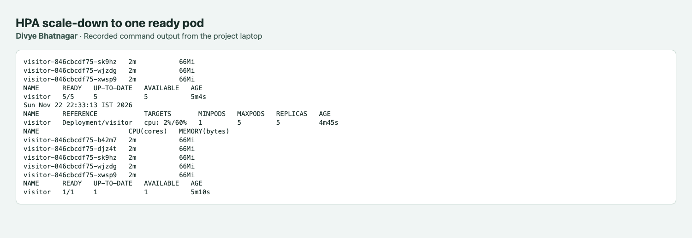
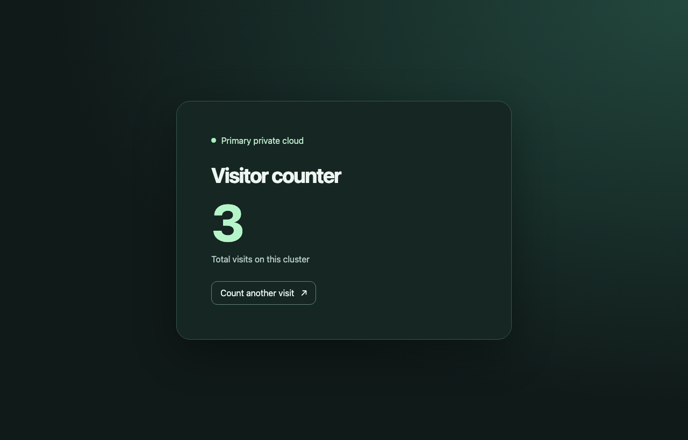
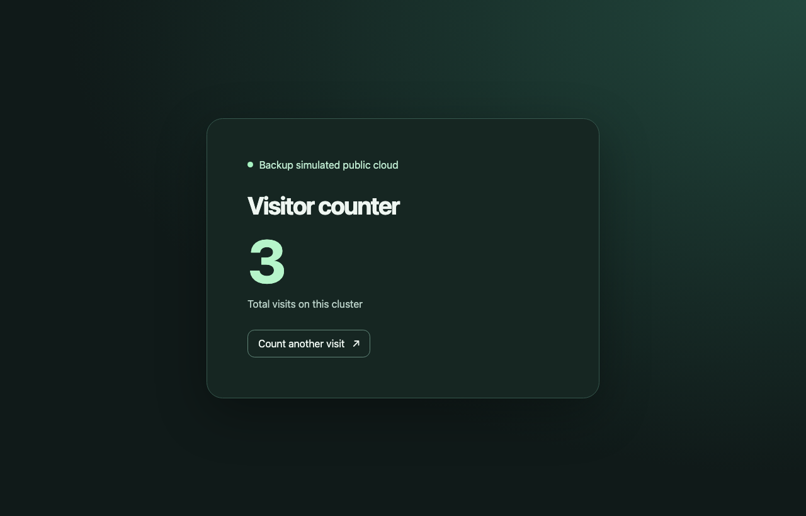
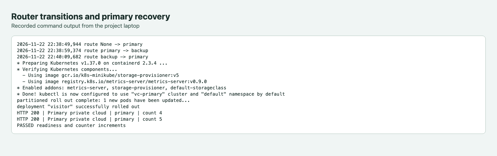

# Deploy a Visitor Counter Web App (Flask + Redis) on Docker and Kubernetes

**Cloud Computing Small Project**

| | |
| --- | --- |
| Subject | Cloud Computing |
| College | IILM Greater Noida |
| Public GitHub repository URL | https://github.com/DivyeBhatnagar/Cloud-Computing-Project-Visitor-Count- |

::: {.page-break}
:::

## 1. Abstract

This project packages a Flask visitor counter and Redis in Docker and deploys them to Kubernetes. It evaluates pod replacement, CPU-driven autoscaling, readiness-based failover between two Minikube profiles, and three resource optimizations on a student laptop. **The hybrid cloud environment was simulated locally with two Minikube clusters.** The public cloud role represents a second local cluster. The experiment used zero paid cloud services and measured local resources.

## 2. Introduction

The visitor counter combines a replaceable Flask web tier with a shared Redis key. Multiple web pods can serve requests from one cluster without maintaining independent counters. Kubernetes can replace failed web pods and adjust replica counts as load changes.

## 3. Objectives

1. Package Flask and Redis as separate containers.
2. Deploy a persistent Redis database and a probed web Deployment on Kubernetes.
3. Measure replica changes under CPU load.
4. Test routing during a primary-cluster outage and recovery.
5. Measure the effect of request right-sizing, idle replica reduction and a smaller base image.

## 4. Technologies Used

Flask renders the interface and Gunicorn serves it. Redis provides atomic `INCR`, readiness `PING` and append-only persistence. Docker Compose runs both containers. Minikube hosts Kubernetes and metrics-server. Python's standard HTTP libraries implement the loopback router and load generator.

## 5. System Requirements

The implementation ran on an Apple M4 laptop with macOS 26.6.2, 10 cores and 16 GB RAM. Docker Engine reported 10 CPUs and about 7.75 GiB of VM memory. Each Minikube profile was allocated two CPUs and 2,560 MiB. Initial available storage was 32 GiB. The build targets Linux ARM64 on this laptop.

## 6. Installation and Setup

Docker Desktop 4.77.0 provided Engine 29.5.3 and Compose 5.1.4. Minikube 1.39.0 and kubectl 1.37.2 were installed with Homebrew. Both clusters ran Kubernetes v1.37.0. Python 3.14.6 ran tests on the host, and the app container used Python 3.12. The repository's setup instructions include Windows through WSL 2.

## 7. System Architecture

{width=100%}

The browser uses port 8088 during failover. The router checks each upstream's `/readyz` via loopback port-forwards to the visitor Services. Each visitor Service targets its own Flask pods. The primary HPA uses metrics-server and a temporary Job generates traffic through the Kubernetes Service.

## 8. Task 1 — Docker Containerization

The Dockerfile builds a slim Python image with pinned direct dependencies and a non-root runtime. Compose starts Redis separately on an internal network, persists data in a named volume and binds the web page to loopback. The container health check calls Flask readiness, which pings Redis.

## 9. Task 2 — Kubernetes Deployment and Self-Healing

The web Deployment has CPU and memory requests and limits, readiness and liveness probes, and a Service. Redis runs as a StatefulSet and stores its append-only file on a 1 GiB PVC. Both profiles showed ready workloads and bound PVCs. The primary's original pod `visitor-857f7d9864-xjts8` was deleted. Kubernetes created `visitor-857f7d9864-v5bnq`, which reached Ready.

## 10. Task 3 — HPA Autoscaling

The autoscaling/v2 HPA targets 60% CPU utilization with a range of one to five replicas. A 150-second Job with 12 concurrent workers sent traffic to the opt-in CPU exercise endpoint. It recorded 4,864 successful requests and seven failures. HPA reported 500% utilization relative to the 100m request and five web replicas reached Ready. After traffic stopped and metrics and stabilization windows elapsed, utilization fell to 2% and the Deployment returned to one ready replica.

## 11. Task 4 — Hybrid Cloud Simulation and Failover

The primary profile represents private cloud and the backup represents public cloud. Both are on the same laptop. The router prefers the ready primary, switches to the ready backup when the primary fails its check, and returns to the primary when it recovers. Each cluster persists its own count. Backup increments stay on the backup, so a displayed count can jump when the route changes. The live stop-and-restart demonstration returned HTTP 200 with increasing counts on the primary, then on the backup while the primary profile was stopped, then on the recovered primary. Router logs recorded both transitions.

## 12. Task 5 — Cost Optimization

The before-and-after tests used a stable idle workload on the same primary node. The experiment reduced per-pod resource requests, replaced three fixed pods with an HPA idle target of one and compared two ARM64 images built from the same Dockerfile. Kubernetes metrics are medians of three snapshots at 20-second intervals. Consecutive snapshots may reuse a metrics-server reading, and startup activity can affect CPU within this idle observation window. CPU is in millicores and memory is in MiB. Requests express scheduler reservations. Usage comes from metrics-server. Image size is Docker's inspected image size in bytes. There were no cloud billing charges or measured monetary savings.

| Metric | Before | After | After minus before | Change (%) |
| --- | ---: | ---: | ---: | ---: |
| idle_replicas | 3 | 1 | -2 | -66.67 |
| cpu_request_m_per_pod | 250 | 100 | -150 | -60.00 |
| memory_request_MiB_per_pod | 128 | 64 | -64 | -50.00 |
| cpu_usage_m_total | 49 | 2 | -47 | -95.92 |
| memory_usage_MiB_total | 198 | 66 | -132 | -66.67 |
| cpu_request_m_total | 750 | 100 | -650 | -86.67 |
| memory_request_MiB_total | 384 | 64 | -320 | -83.33 |
| image_bytes | 404473719 | 47152940 | -357320779 | -88.34 |

## 13. Testing Methodology

The test suite exercises increment behavior, health and readiness, simulated Redis errors, the opt-in load endpoint, counter sharing between app instances with a live Redis server, and router behavior across readiness transitions. Compose is checked via HTTP and container health. Kubernetes validation checks workloads, pod replacement, HPA metrics and ready replicas. The failover test stops and restarts the primary Minikube profile and verifies route headers and visitor increment behavior.

## 14. Results and Observations

| Validation | Status |
| --- | --- |
| Python endpoint, Redis integration and local router tests | PASSED, six tests |
| Compose health and consecutive visits | PASSED |
| Both profiles, ready workloads, PVCs and manifest validation | PASSED |
| Flask pod replacement | PASSED |
| Autoscaling up | PASSED, one to five ready pods |
| Autoscaling down | PASSED, five to one ready pods |
| Profile-level failover and recovery | PASSED, primary → backup → primary |
| Cost comparison | PASSED, three technique comparisons measured |

## 15. Screenshots with Captions

{width=85%}

{width=85%}

{width=85%}

{width=85%}

{width=85%}

{width=85%}

{width=85%}

The [screenshot index](../screenshots/README.md) lists the configured capture commands. The command screenshots show excerpts from the original [validation logs](../evidence/). The public repository screenshot is included as `screenshots/23-github.png`.

## 16. Challenges and Troubleshooting

Docker Desktop was already installed but the engine was initially unavailable. Starting Docker Desktop and verifying the engine restored access. Initial HPA CPU utilization was unknown while metrics were warming up. Kubernetes then recorded valid CPU utilization and scaled. The local routing approach uses retrying port-forwards because stopping a Minikube profile closes that profile's connection.

## 17. Limitations

Both profiles, the router and their local storage share one laptop and Docker VM. A host outage affects both clusters. Independent counters can diverge, and restoring the primary does not transfer backup increments. Router readiness is sampled before forwarding, so a request can encounter a failure during the transition. AOF persistence can lose recent writes during an abrupt crash, depending on the flush interval. The load endpoint produces synthetic CPU work and the idle measurements do not represent a production workload.

## 18. Conclusion

The project demonstrates container packaging, persistent Redis, replaceable Kubernetes web pods and CPU-based scaling. The router served the backup during a primary outage and returned to the primary after recovery. The three resource comparisons recorded lower scheduling requests, fewer idle Flask replicas and a smaller ARM64 image.

## 19. Future Scope

A production design could evaluate a managed or replicated data layer, redundant routers, TLS and a measured service-level objective. Additional experiments could compare request latency and error rates with different CPU and memory requests.

## 20. References

- [Docker Desktop for Mac](https://docs.docker.com/desktop/setup/install/mac-install/)
- [Minikube Docker driver](https://minikube.sigs.k8s.io/docs/drivers/docker/)
- [Kubernetes Horizontal Pod Autoscaling](https://kubernetes.io/docs/concepts/workloads/autoscaling/horizontal-pod-autoscale/)
- [Redis INCR command](https://redis.io/docs/latest/commands/incr/)
- [GitHub CLI repository creation](https://cli.github.com/manual/gh_repo_create)

## 21. Public GitHub Repository Link

https://github.com/DivyeBhatnagar/Cloud-Computing-Project-Visitor-Count-
