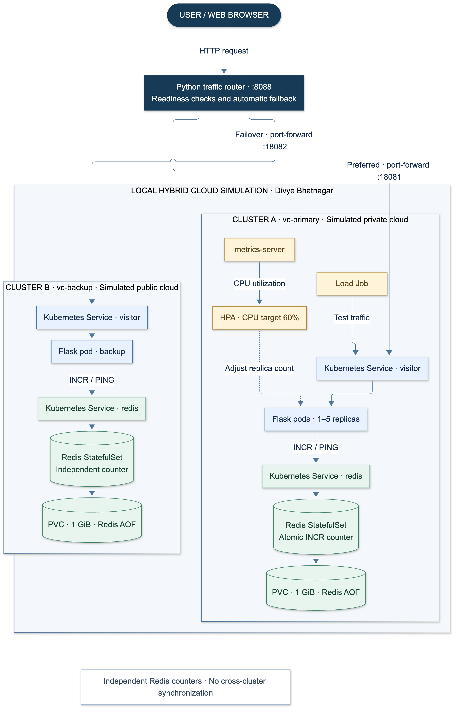
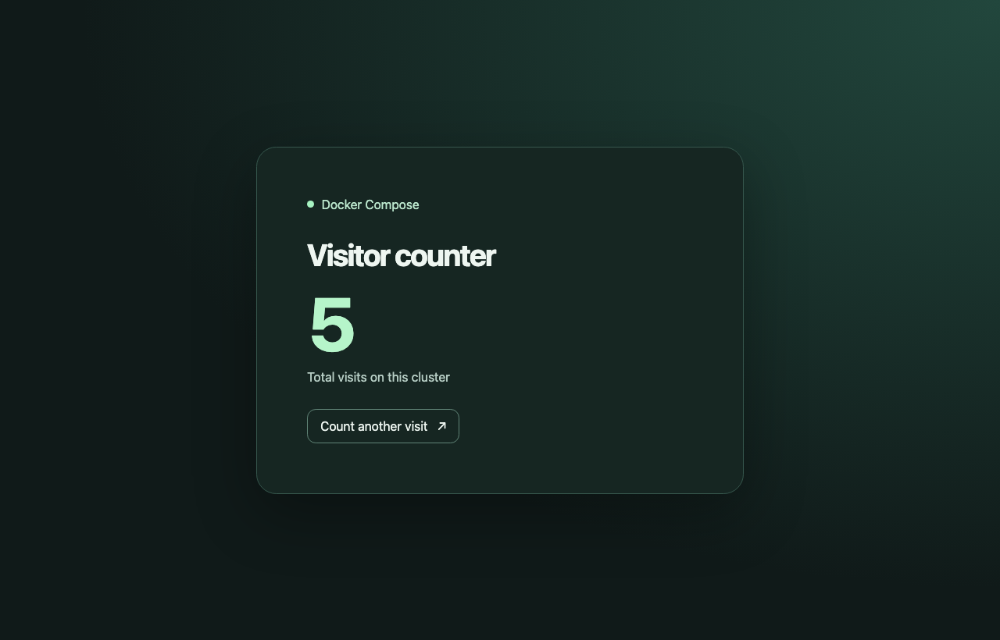
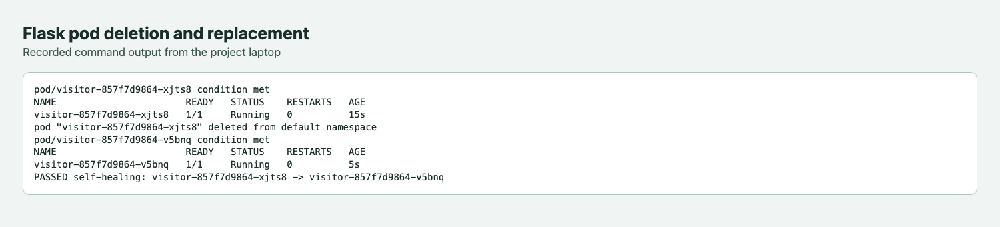
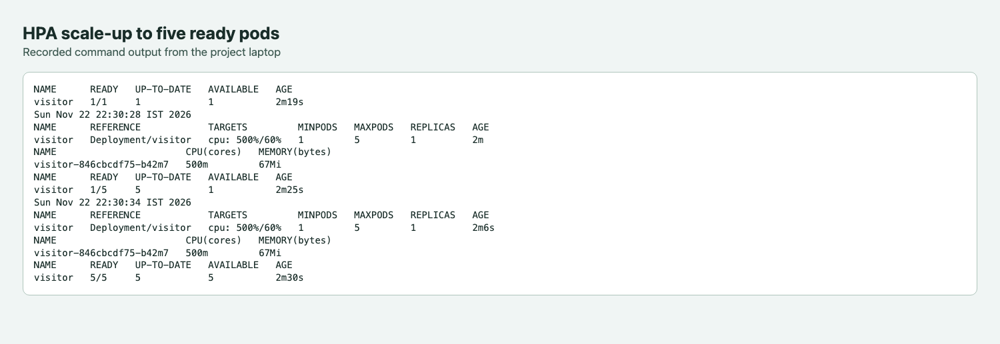
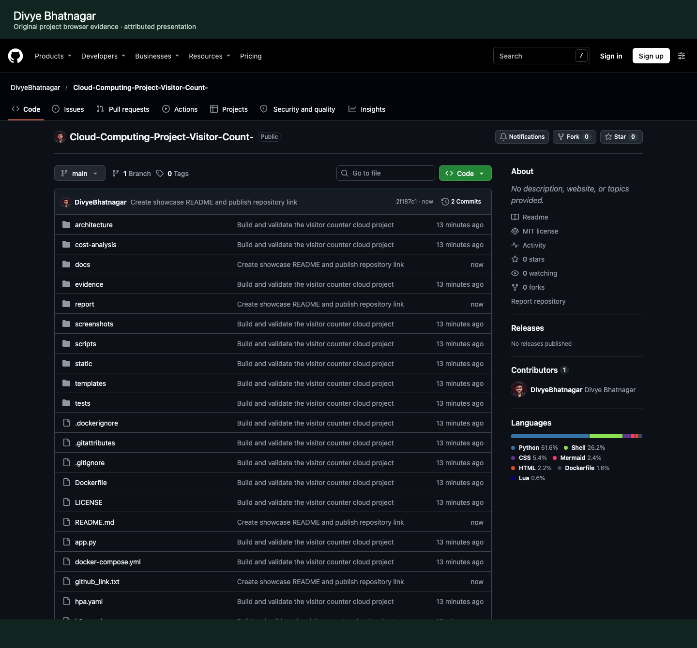

# Deploy a Visitor Counter Web App (Flask + Redis) on Docker and Kubernetes

**Cloud Computing Project**

| | |
| --- | --- |
| Subject | Cloud Computing Project |
| Name | Divye Bhatnagar |
| Submitted to | Mr. Rohit Kumar |
| Roll number | 2410030210 |
| Section | 3CSE2 |
| College | IILM University, Greater Noida |
| Public GitHub repository URL | https://github.com/DivyeBhatnagar/Cloud-Computing-Project-Visitor-Count- |

::: {.page-break}
:::

## 1. Abstract

This project packages a Flask visitor counter and Redis in Docker and deploys them to Kubernetes. It evaluates pod replacement, CPU-driven autoscaling, readiness-based failover between two Minikube profiles, and three resource optimizations on a student laptop. **The hybrid cloud environment was simulated locally with two Minikube clusters.** The public cloud role represents a second local cluster. The experiment used zero paid cloud services and measured local resources.

## 2. Introduction

The visitor counter combines a replaceable Flask web tier with a shared Redis key. Multiple web pods can serve requests from one cluster without maintaining independent counters. Kubernetes can replace failed web pods and adjust replica counts as load changes.

## 3. Objectives

The practical work follows the lifecycle of a small cloud application. Containerization establishes a repeatable runtime, Kubernetes manages the running application, and the experiments test how that deployment behaves when demand or availability changes. The optimization exercise then examines the resources required to keep the application available at idle.

1. Package Flask and Redis as separate containers.
2. Deploy a persistent Redis database and a probed web Deployment on Kubernetes.
3. Measure replica changes under CPU load.
4. Test routing during a primary-cluster outage and recovery.
5. Measure the effect of request right-sizing, idle replica reduction and a smaller base image.

## 4. Technologies Used

Flask renders the interface and Gunicorn serves it. Redis provides atomic `INCR`, readiness `PING` and append-only persistence. Docker Compose runs both containers. Minikube hosts Kubernetes and metrics-server. Python's standard HTTP libraries implement the loopback router and load generator.

| Component | Version or role in the implementation |
| --- | --- |
| Flask | 3.1.3, application routing and HTML rendering |
| Redis Python client | 7.3.0, communication with the Redis server |
| Gunicorn | 25.1.0, application server inside the web container |
| Container runtime | Docker Desktop with Linux ARM64 containers |
| Kubernetes distribution | Two independent Minikube profiles |
| Monitoring | metrics-server for CPU and memory observations |
| Automation | Python and Bash scripts stored in the repository |

## 5. System Requirements

The implementation uses two profiles to keep the cluster contexts, Services, workloads and volumes independent. The host must still provide enough capacity for both control planes, the application pods, the database pods and the temporary load Job. Consequently, the two-cluster exercise requires more host resources than the Compose demonstration.

The implementation ran on an Apple M4 laptop with macOS 26.6.2, 10 cores and 16 GB RAM. Docker Engine reported 10 CPUs and about 7.75 GiB of VM memory. Each Minikube profile was allocated two CPUs and 2,560 MiB. Initial available storage was 32 GiB. The build targets Linux ARM64 on this laptop.

## 6. Installation and Setup

Docker Desktop 4.77.0 provided Engine 29.5.3 and Compose 5.1.4. Minikube 1.39.0 and kubectl 1.37.2 were installed with Homebrew. Both clusters ran Kubernetes v1.37.0. Python 3.14.6 ran tests on the host, and the app container used Python 3.12. The repository's setup instructions include Windows through WSL 2.

The setup procedure starts by confirming that Docker Engine is reachable. The web image is built locally and loaded into each Minikube profile. The deployment script applies the Kubernetes resources, sets a visible cluster identifier and waits for the StatefulSet and Deployment to become ready. Commands include the selected context explicitly so that an operation intended for the primary is applied to the correct cluster.

| Stage | Verification command | Expected evidence |
| --- | --- | --- |
| Docker engine | `docker version` | Client and server version information |
| Compose stack | `docker compose ps` | Healthy web and Redis containers |
| Cluster profiles | `minikube profile list` | Both project profiles listed |
| Workload readiness | `kubectl --context vc-primary get pods` | Flask and Redis pods ready |
| Persistent storage | `kubectl --context vc-primary get pvc` | Redis claim bound |
| CPU observations | `kubectl --context vc-primary top pod` | Pod CPU and memory readings |

## 7. System Architecture

{width=100%}

The browser uses port 8088 during failover. The router checks each upstream's `/readyz` via loopback port-forwards to the visitor Services. Each visitor Service targets its own Flask pods. The primary HPA uses metrics-server and a temporary Job generates traffic through the Kubernetes Service.

### 7.1 Request processing and shared state

A request to the home page calls Redis `INCR` for the configured counter key. Redis performs the increment as one atomic operation, which prevents two web processes from independently reading the same old value and overwriting one another's updates. Flask renders the returned value in the response. The value describes visits handled by that cluster's Redis database.

The Flask web tier can therefore be replaced without storing the count in the web container. Configuration is supplied through environment variables, including the Redis connection URL, the counter key and the cluster identifier. The cluster identifier appears on the page and in the response header, allowing the failover test to verify which upstream answered a request.

### 7.2 Health, readiness and failure handling

| Endpoint | Behaviour | Operational purpose |
| --- | --- | --- |
| `/` | Increments the Redis key and renders the count | Demonstrates shared application state |
| `/healthz` | Returns the Flask process status | Allows Kubernetes to check process health |
| `/readyz` | Sends a Redis `PING` | Checks whether the application can serve counter requests |
| `/demo-load` | Runs a fixed CPU workload when enabled | Produces reproducible CPU demand for the HPA exercise |

A Redis connection error causes the counter page to return HTTP 503 with an unavailable message. Readiness also fails during that condition. Liveness remains independent of Redis availability, allowing a healthy application process to recover when the database becomes reachable again.

## 8. Task 1 — Docker Containerization

The Dockerfile builds a slim Python image with pinned direct dependencies and a non-root runtime. Compose starts Redis separately on an internal network, persists data in a named volume and binds the web page to loopback. The container health check calls Flask readiness, which pings Redis.

### 8.1 Image construction

The Docker build copies the dependency list before the application files. This permits reuse of the dependency installation layer when only the HTML or application source changes. The final runtime contains the application, templates and static stylesheet. The `.dockerignore` file restricts the build context to those required files, keeping the local virtual environment and evidence files out of the image.

Gunicorn listens on container port 8000 and runs two worker processes. The image runs under numeric user 10001 instead of the root user. A health check requests the local readiness endpoint, so the Compose status reflects both the web process and its ability to contact Redis.

### 8.2 Container networking and persistence

| Item | Implementation | Reason |
| --- | --- | --- |
| Web service | Locally built `visitor-counter:local` image | Runs the Flask application |
| Redis service | `redis:7.4-alpine` | Provides the shared counter store |
| Service discovery | Compose service name `redis` | Allows the web container to locate Redis |
| Browser access | Loopback port 8080 mapped to port 8000 | Makes the web page available on the laptop |
| Data volume | Named volume mounted at `/data` | Retains the Redis files across container recreation |
| Startup dependency | Web waits for the Redis health check | Reduces initial connection failures |

The Compose smoke test requests readiness and then makes two isolated visits. It extracts the displayed counts and requires the second value to equal the first plus one. Keeping other visits out of the test window makes that assertion reproducible.

## 9. Task 2 — Kubernetes Deployment and Self-Healing

The web Deployment has CPU and memory requests and limits, readiness and liveness probes, and a Service. Redis runs as a StatefulSet and stores its append-only file on a 1 GiB PVC. Both profiles showed ready workloads and bound PVCs. The primary's original pod `visitor-857f7d9864-xjts8` was deleted. Kubernetes created `visitor-857f7d9864-v5bnq`, which reached Ready.

### 9.1 Kubernetes resources

| Resource | Name | Function |
| --- | --- | --- |
| Deployment | `visitor` | Maintains the desired number of web pods |
| Service | `visitor` | Provides a stable endpoint for ready web pods |
| StatefulSet | `redis` | Maintains the Redis pod and its storage identity |
| Headless Service | `redis` | Provides Redis discovery within the cluster |
| PersistentVolumeClaim | `data-redis-0` | Requests 1 GiB of persistent Redis storage |
| HorizontalPodAutoscaler | `visitor` | Adjusts the primary web replica count from CPU observations |

The local image uses `imagePullPolicy: Never`, so it must be loaded into a profile before deployment. Labels connect the Service selectors to the intended pods. The visitor Service exposes port 80 and directs traffic to the web container's named HTTP port.

### 9.2 Resource allocation and recovery

| Container | CPU request | CPU limit | Memory request | Memory limit |
| --- | ---: | ---: | ---: | ---: |
| Flask web | 100m | 500m | 64 MiB | 192 MiB |
| Redis | 50m | 250m | 32 MiB | 128 MiB |

The scheduler uses requests when deciding where a pod can run. Limits constrain runtime resource consumption. For example, the 500m web CPU limit corresponds to half of one CPU core. The HPA uses the web CPU request as the reference for utilization, making this allocation relevant to both scheduling and scaling.

For self-healing, the test records the current Flask pod name, deletes that pod and waits for a different pod to become ready. A different pod identity confirms that Kubernetes created a replacement. The test also checks application access after the forwarding connection reconnects. The exercise demonstrates recovery of the web workload while the Redis workload retains the counter state.

## 10. Task 3 — HPA Autoscaling

The autoscaling/v2 HPA targets 60% CPU utilization with a range of one to five replicas. A 150-second Job with 12 concurrent workers sent traffic to the opt-in CPU exercise endpoint. It recorded 4,864 successful requests and seven failures. HPA reported 500% utilization relative to the 100m request and five web replicas reached Ready. After traffic stopped and metrics and stabilization windows elapsed, utilization fell to 2% and the Deployment returned to one ready replica.

### 10.1 Experiment configuration

| Parameter | Value used |
| --- | --- |
| HPA API | `autoscaling/v2` |
| Minimum and maximum replicas | 1 and 5 |
| CPU utilization target | 60% of requested CPU |
| Scale-down stabilization | 60 seconds |
| Load duration | 150 seconds |
| Concurrent load workers | 12 |
| Load destination | Kubernetes visitor Service |

The load Job sends requests through the Service so that new connections can reach additional replicas as they become ready. The optional endpoint performs a fixed password-hashing workload, creating CPU demand without incrementing the visitor count. The endpoint is disabled again after the scaling demonstration.

### 10.2 Reading the scaling observations

An observed usage of 500m against a request of 100m corresponds to 500% utilization. The value can exceed 100% because utilization is measured relative to the request. The recorded 500% reading exceeded the 60% target and the HPA increased the desired replica count up to the configured maximum.

The Job recorded 4,871 completed request attempts, comprising 4,864 successes and seven failures. Dividing successes by completed attempts gives approximately 99.86% for this particular experiment. This is a calculated result from the recorded Job output. The experiment did not collect request latency percentiles, and this ratio does not establish a long-term availability target.

After the Job finished, CPU utilization fell and the Deployment eventually returned to one ready pod. Metrics collection, controller decisions, pod startup and the stabilization window all contribute to the time between a demand change and an observed replica change.

## 11. Task 4 — Hybrid Cloud Simulation and Failover

The primary profile represents private cloud and the backup represents public cloud. Both are on the same laptop. The router prefers the ready primary, switches to the ready backup when the primary fails its check, and returns to the primary when it recovers. Each cluster persists its own count. Backup increments stay on the backup, so a displayed count can jump when the route changes. The live stop-and-restart demonstration returned HTTP 200 with increasing counts on the primary, then on the backup while the primary profile was stopped, then on the recovered primary. Router logs recorded both transitions.

### 11.1 Routing and recovery procedure

| Stage | Primary condition | Verified route | Observation |
| --- | --- | --- | --- |
| Normal service | Running and ready | Primary | HTTP 200 and increasing primary counter |
| Simulated outage | Minikube profile stopped | Backup | HTTP 200 and increasing backup counter |
| Recovery | Profile restarted and readiness restored | Primary | Router returned to the recovered primary |

The router checks the primary readiness endpoint before forwarding each request. If that check fails, it checks the backup. A responding but unready web application is excluded because the readiness check includes Redis. Retrying port-forward scripts reconnect when a pod is replaced or the primary profile restarts.

A request that has already reached an upstream may fail while the profile is stopping. Replaying that request automatically could increment Redis twice if the first increment committed before the connection failed. The router therefore reports a forwarding error instead of automatically replaying an uncertain application request.

### 11.2 State consistency

Redis persistence belongs to its own cluster. Visits served by the primary and visits served by the backup are stored under separate keys in separate Redis instances. Consequently, the backup may display a smaller count and failback may show another value. The demonstration verifies application routing and local database persistence, while leaving cross-cluster data replication as future work.

Stopping a Minikube profile preserves its project storage for the recovery step. Deleting the profile removes the cluster and can discard its local data. The cleanup instructions distinguish stopping the demonstration from deliberately deleting its persisted state.

## 12. Task 5 — Cost Optimization

The before-and-after tests used a stable idle workload on the same primary node. The experiment reduced per-pod resource requests, replaced three fixed pods with an HPA idle target of one and compared two ARM64 images built from the same Dockerfile. Kubernetes metrics are medians of three snapshots at 20-second intervals. Consecutive snapshots may reuse a metrics-server reading, and startup activity can affect CPU within this idle observation window. CPU is in millicores and memory is in MiB. Requests express scheduler reservations. Usage comes from metrics-server. Image size is Docker's inspected image size in bytes. There were no cloud billing charges or measured monetary savings.

| Metric | Before | After | After minus before | Change (%) |
| --- | ---: | ---: | ---: | ---: |
| Idle Flask replicas | 3 | 1 | -2 | -66.67 |
| CPU request per pod (m) | 250 | 100 | -150 | -60.00 |
| Memory request per pod (MiB) | 128 | 64 | -64 | -50.00 |
| Total CPU usage (m) | 49 | 2 | -47 | -95.92 |
| Total memory usage (MiB) | 198 | 66 | -132 | -66.67 |
| Total CPU request (m) | 750 | 100 | -650 | -86.67 |
| Total memory request (MiB) | 384 | 64 | -320 | -83.33 |
| Image size (bytes) | 404473719 | 47152940 | -357320779 | -88.34 |

### 12.1 Measurement procedure

The baseline used three idle Flask replicas with requests of 250m CPU and 128 MiB memory per pod. The optimized configuration used requests of 100m and 64 MiB and allowed the HPA to converge to one idle pod. The script read live pod specifications for allocations and `kubectl top` for observed usage. Both phases used three snapshots separated by 20 seconds.

| Snapshot | Baseline CPU usage | Optimized CPU usage | Baseline memory usage | Optimized memory usage |
| --- | ---: | ---: | ---: | ---: |
| 1 | 49m | 2m | 198 MiB | 66 MiB |
| 2 | 49m | 2m | 198 MiB | 66 MiB |
| 3 | 9m | 2m | 198 MiB | 66 MiB |
| Median | 49m | 2m | 198 MiB | 66 MiB |

The CPU observations varied during the baseline window. Two observations were 49m and one was 9m, so the median was 49m. This variation limits how broadly the observed usage reduction can be interpreted. The allocation reductions are directly reproducible from the requested resources and number of pods.

### 12.2 Calculations and interpretation

Absolute change is calculated as the after value minus the before value. Percentage change is that difference divided by the before value, multiplied by 100. For image size, the difference was 47,152,940 − 404,473,719 = −357,320,779 bytes, corresponding to an 88.34% reduction.

Right-sizing reduced CPU request per pod by 150m and memory request per pod by 64 MiB. Reducing three idle pods to one removed two sets of web-process overhead. Together, these changes reduced the total web CPU request from 750m to 100m and total memory request from 384 MiB to 64 MiB.

The full and slim image comparison used the same application and direct dependency versions on ARM64. Image size came from `docker image inspect`. It describes the inspected image, including layers, and does not directly measure network download size or physical disk savings when layers are shared.

The recorded image sizes belong to the measured experiment build. Later additions to presentation text and attribution can change the current build size slightly. The raw experiment records remain the basis for the reported comparison.

## 13. Testing Methodology

The test suite exercises increment behavior, health and readiness, simulated Redis errors, the opt-in load endpoint, counter sharing between app instances with a live Redis server, and router behavior across readiness transitions. Compose is checked via HTTP and container health. Kubernetes validation checks workloads, pod replacement, HPA metrics and ready replicas. The failover test stops and restarts the primary Minikube profile and verifies route headers and visitor increment behavior.

### 13.1 Validation criteria

| Test area | Check performed | Pass condition |
| --- | --- | --- |
| Flask | Home page, health, readiness and Redis errors | Expected status code and rendered response |
| Redis integration | Two independent Flask instances use one key | Both instances observe successive increments |
| Router | Primary, backup, recovery and total outage | Expected route or HTTP 503 when neither is ready |
| Docker Compose | Container health and HTTP smoke test | Both services healthy and consecutive counts correct |
| Kubernetes | Rollout status, running pods and bound PVCs | Workloads ready and persistent claim bound |
| Self-healing | Delete the web pod and observe replacement | A different web pod reaches Ready |
| HPA | Observe replicas during and after load | Ready replicas rise and later return to one |
| Failover | Stop and restart the primary profile | Backup serves requests and primary resumes after recovery |

The unit tests use controlled test doubles for Redis error paths. A separate integration test uses a temporary live Redis instance and a unique key, then removes that test key. Router tests run local HTTP fixtures to exercise route selection without requiring Kubernetes.

The recorded cluster demonstrations provide evidence beyond the automated endpoint tests. Windows instructions are included for portability, but the practical results in this report were obtained on macOS ARM64. The standalone Docker command sequence is documented, while the full two-container stack was validated through Compose.

## 14. Results and Observations

| Validation | Status |
| --- | --- |
| Python endpoint, Redis integration and local router tests | PASSED, six tests |
| Compose health and consecutive visits | PASSED |
| Both profiles, ready workloads, PVCs and manifest validation | PASSED |
| Flask pod replacement | PASSED |
| Autoscaling up | PASSED, one to five ready pods |
| Autoscaling down | PASSED, five to one ready pods |
| Profile-level failover and recovery | PASSED, primary → backup → primary |
| Cost comparison | PASSED, three technique comparisons measured |

The results show that a shared Redis store permits the web tier to be replaced and scaled within one cluster. The HPA experiment also demonstrates that scaling takes time, since new pods must start and supply readiness and CPU observations before the controller can use them reliably.

The failover result establishes that the router can select a second ready local cluster when the primary profile is unavailable. It does not establish continuous availability during every possible host or network failure. Both clusters remain dependent on the same laptop and Docker environment.

The evidence files connect each reported result to a reproducible command or script. The recorded request failures, startup metric delays and independent counters are retained in the observations so that the outcome can be evaluated with its practical limitations.

## 15. Screenshots with Captions

{width=85%}

{width=85%}

{width=85%}

{width=85%}

{width=85%}

{width=85%}

{width=85%}

The [screenshot index](../screenshots/README.md) lists the configured capture commands. The command screenshots show excerpts from the original [validation logs](../evidence/).

{width=85%}

## 16. Challenges and Troubleshooting

Docker Desktop was already installed but the engine was initially unavailable. Starting Docker Desktop and verifying the engine restored access. Initial HPA CPU utilization was unknown while metrics were warming up. Kubernetes then recorded valid CPU utilization and scaled. The local routing approach uses retrying port-forwards because stopping a Minikube profile closes that profile's connection.

| Challenge encountered | Cause or symptom | Resolution used |
| --- | --- | --- |
| Docker Engine initially unavailable | CLI installed but server connection failed | Started Docker Desktop and verified server details |
| Initial HPA metrics unknown | New pods had insufficient usable CPU observations | Waited for metrics and inspected HPA conditions |
| Forwarding connection closed | Pod replacement or primary profile stop | Retrying port-forward script reconnected |
| Different counts after failover | Separate Redis datasets | Documented cluster-local counting explicitly |

For demonstration troubleshooting, the useful first checks are workload readiness, Redis connectivity and the active context. A healthy Flask process can still return unavailable counter responses if Redis is unreachable. Inspecting `/readyz`, pod events and application logs helps locate that dependency failure.

## 17. Limitations

Both profiles, the router and their local storage share one laptop and Docker VM. A host outage affects both clusters. Independent counters can diverge, and restoring the primary does not transfer backup increments. Router readiness is sampled before forwarding, so a request can encounter a failure during the transition. AOF persistence can lose recent writes during an abrupt crash, depending on the flush interval. The load endpoint produces synthetic CPU work and the idle measurements do not represent a production workload.

The measurements cover a small number of snapshots under one laptop configuration. They provide a controlled comparison for this project, but a longer experiment would be required to characterize steady-state CPU usage, peak memory, request latency and recovery time. Those quantities were not independently benchmarked in the recorded run.

The current public repository includes source code, manifests, scripts, diagrams, raw logs, CSV measurements and attributed screenshots. The evidence captures identify Divye Bhatnagar, and the browser evidence is presented inside a labeled attribution frame. This keeps authorship visible while distinguishing the recorded page from its presentation.

## 18. Conclusion

The project demonstrates container packaging, persistent Redis, replaceable Kubernetes web pods and CPU-based scaling. The router served the backup during a primary outage and returned to the primary after recovery. The three resource comparisons recorded lower scheduling requests, fewer idle Flask replicas and a smaller ARM64 image.

## 19. Future Scope

A production design could evaluate a managed or replicated data layer, redundant routers, TLS and a measured service-level objective. Additional experiments could compare request latency and error rates with different CPU and memory requests.

| Proposed extension | Evaluation required |
| --- | --- |
| Cross-cluster Redis strategy | Write consistency, replication delay and behaviour during recovery |
| Redundant traffic routers | Removal of the router as a single failure point |
| Longer load experiments | Latency percentiles, error rates and sustained CPU usage |
| Broader resource tuning | Memory peaks, scheduling capacity and scaling sensitivity |
| Independent infrastructure | Behaviour when clusters use separate physical failure domains |

These extensions would build on the current local demonstration. Each would require its own test procedure and evidence before making stronger availability or performance claims.

## 20. References

- [Docker Desktop for Mac](https://docs.docker.com/desktop/setup/install/mac-install/)
- [Minikube Docker driver](https://minikube.sigs.k8s.io/docs/drivers/docker/)
- [Kubernetes Horizontal Pod Autoscaling](https://kubernetes.io/docs/concepts/workloads/autoscaling/horizontal-pod-autoscale/)
- [Redis INCR command](https://redis.io/docs/latest/commands/incr/)
- [GitHub CLI repository creation](https://cli.github.com/manual/gh_repo_create)

## 21. Public GitHub Repository Link

https://github.com/DivyeBhatnagar/Cloud-Computing-Project-Visitor-Count-
